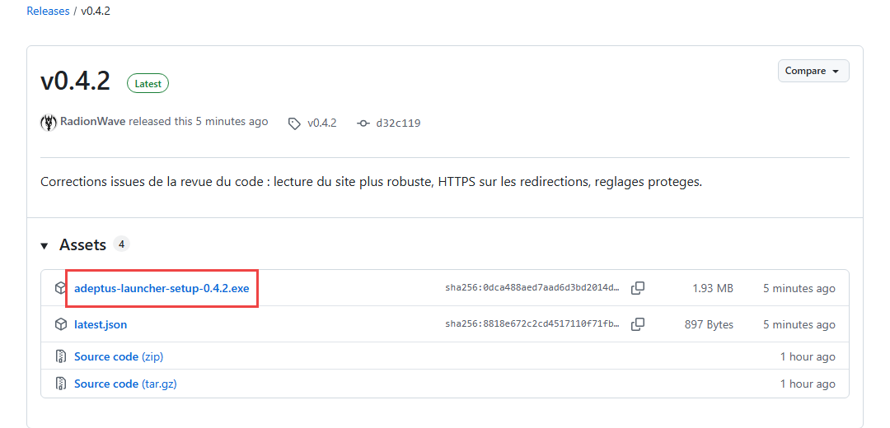
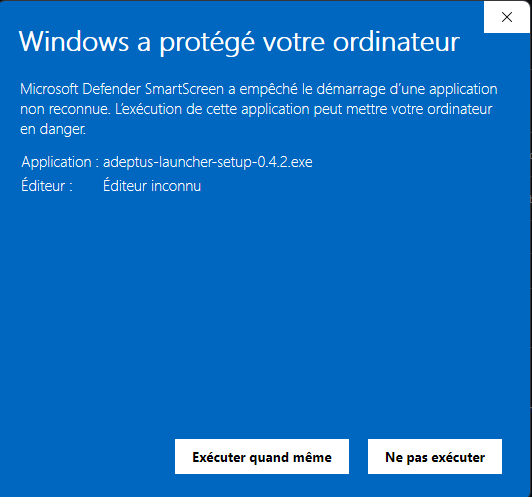
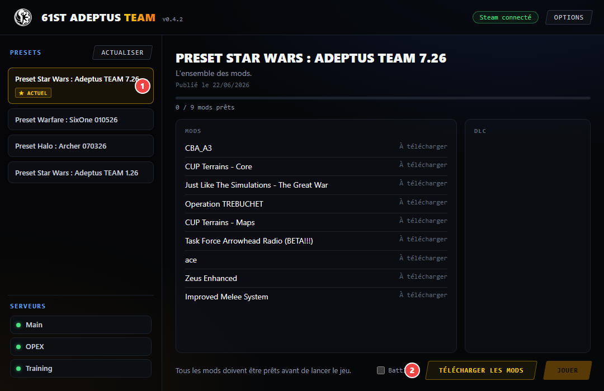
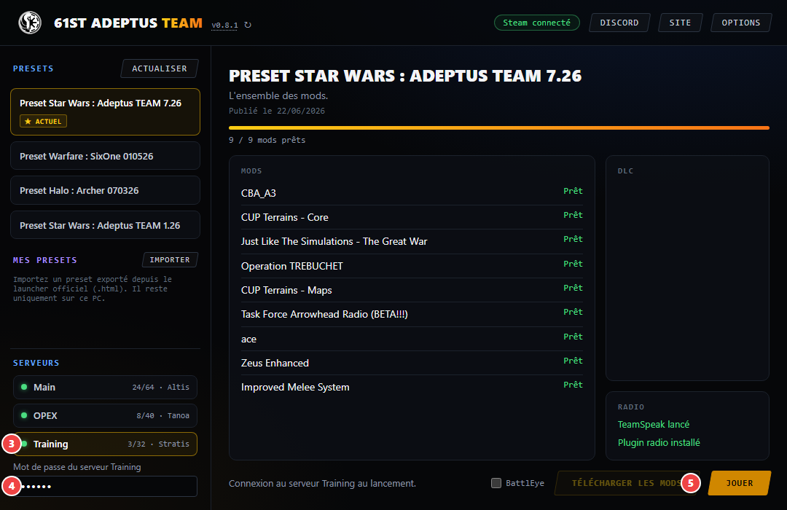

# 61st Adeptus TEAM Launcher

Le launcher de la 61st Adeptus TEAM télécharge les mods de l'opération et vous connecte à nos serveurs en quelques clics.

**Il vous faut :** Windows, Steam, et Arma 3 sur votre compte Steam.

## 1. Télécharger

Ouvrez la [dernière version](https://github.com/RadionWave/61st-Adeptus-Launcher-Releases/releases/latest), puis cliquez sur le fichier `adeptus-launcher-setup-….exe` dans la partie **Assets**.

## 2. Installer

Lancez le fichier téléchargé et suivez les étapes. Aucun droit administrateur n'est nécessaire.

Si Windows affiche « Windows a protégé votre ordinateur », cliquez sur **Informations complémentaires**, puis sur **Exécuter quand même**. Cet avertissement apparaît parce que le launcher n'a pas de certificat Windows.

Vous retrouverez ensuite le launcher dans le menu Démarrer, sous le nom **Adeptus TEAM Launcher**.

## 3. Télécharger les mods

Lancez Steam, puis le launcher.

1. Choisissez un preset. Celui de l'opération en cours porte la mention **★ ACTUEL**.
2. Cliquez sur **Télécharger les mods**, puis attendez que tous les mods affichent **Prêt**. Le premier téléchargement peut être long.

## 4. Jouer

3. Choisissez un serveur. Une pastille verte indique qu'il est en ligne.
4. Saisissez le mot de passe du serveur, disponible sur le Discord de la team. Il est retenu pour les prochaines fois.
5. Cliquez sur **Jouer** : le jeu se lance et rejoint le serveur.

Pour lancer le jeu sans rejoindre de serveur, cliquez de nouveau sur le serveur sélectionné pour le désélectionner, puis sur **Jouer**.

Laissez la case **BattlEye** décochée, sauf si un serveur l'exige.

## Bon à savoir

- **Mises à jour :** le launcher se met à jour tout seul. Si le bouton **Mettre à jour** apparaît à côté du numéro de version, cliquez dessus une fois le jeu fermé.
- **Langue :** le launcher existe aussi en anglais, dans **Options**.

## En cas de problème

- **« Steam non connecté » :** lancez Steam, puis cliquez sur **Actualiser**.
- **Le bouton Jouer reste grisé :** vérifiez que tous les mods affichent **Prêt** et qu'Arma 3 n'est pas déjà lancé.
- **Le serveur refuse la connexion :** vérifiez que vous avez sélectionné le bon preset et le bon mot de passe.
- **Bandeau jaune « Site injoignable » :** vous pouvez quand même jouer, mais les presets ne sont peut-être pas à jour.

## Utilisation de l'IA

Ce projet est réalisé uniquement à des fins récréatives. Il a été développé avec Claude (Anthropic), via Claude Code : l'IA a écrit le code, les scripts et la documentation, et a effectué des tests et des publications à la demande. Le choix des fonctionnalités, la validation dans le jeu et la gestion de la clé de signature restent assurés par un humain.
